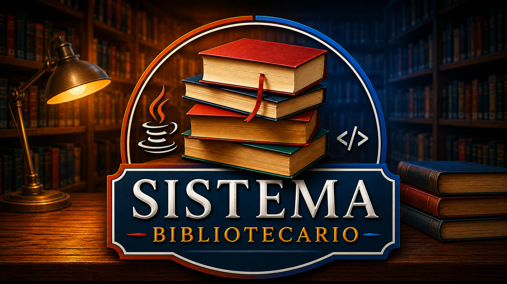
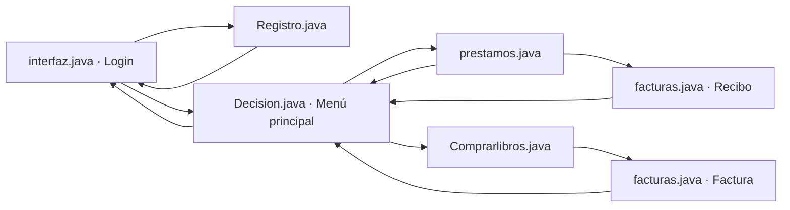

<div align="center">

<p align="center">
  
</p>

<p align="center">
  
</p>

Aplicación de escritorio desarrollada en Java Swing para simular usuarios, préstamos, compras de libros, facturas y recibos dentro de un entorno bibliotecario académico.

[](#-estado-del-proyecto)
[](https://github.com/Jairo0811/SistemaBibliotecario/releases/latest)
[](https://www.java.com/)
[](https://netbeans.apache.org/)
[](https://ant.apache.org/)
[](https://github.com/Jairo0811/SistemaBibliotecario/actions/workflows/build-release.yml)

> Estado actual: **proyecto académico de 2016 restaurado en 2026, funcional, documentado y congelado como software legado de portafolio.**

</div>

---

## ⬇️ Descargar y ejecutar

Los ejecutables oficiales se publican en **[GitHub Releases](https://github.com/Jairo0811/SistemaBibliotecario/releases/latest)** y se generan automáticamente con GitHub Actions a partir del código de este repositorio.

| Opción | Archivo | ¿Requiere Java instalado? | Cómo ejecutar |
|---|---|:---:|---|
| 🪟 **Paquete Windows** (recomendado) | [`SistemaBibliotecario-Windows-x64.zip`](https://github.com/Jairo0811/SistemaBibliotecario/releases/latest/download/SistemaBibliotecario-Windows-x64.zip) | ❌ No, incluye runtime Java | Descomprimir y abrir `SistemaBibliotecario.exe` |
| ☕ **JAR ejecutable** | [`SistemaBibliotecario.jar`](https://github.com/Jairo0811/SistemaBibliotecario/releases/latest/download/SistemaBibliotecario.jar) | ✅ Java 8 o superior | `java -jar SistemaBibliotecario.jar` |
| 🛠️ **Código fuente** | Este repositorio | ✅ JDK 8 o superior | Ver [Compilar desde el código fuente](#compilar-desde-el-codigo-fuente) |

> El paquete Windows contiene `SistemaBibliotecario.exe` junto con un runtime Java integrado generado con `jpackage`; no necesita una instalación externa de Java. Más detalles en [`docs/EXECUTABLE.md`](docs/EXECUTABLE.md).

### 🔐 Cuenta de demostración

| Campo | Valor |
|---|---|
| Usuario | `admin` |
| Contraseña | `1234` |

También puedes crear una cuenta desde **Sign Up**. El registro restaurado es **de sesión**: el usuario creado puede iniciar sesión mientras la aplicación permanezca abierta, pero se pierde al cerrarla. `admin / 1234` es siempre la cuenta oficial de demostración.

---

## 📌 Descripción

**Sistema Bibliotecario** es una aplicación de escritorio creada originalmente como proyecto final grupal de la asignatura **Programación 1 (SOF-003)** del **Instituto Tecnológico de las Américas (ITLA)** durante el período **2016-C3**.

El sistema fue desarrollado con **Java Swing** en **Apache NetBeans** y simula procesos básicos de una biblioteca: registro de usuarios, inicio de sesión, consulta de libros, préstamos, compras y generación de comprobantes.

En **2026** el proyecto fue restaurado, corregido y documentado para que funcione en versiones modernas de Java. Se conservó la identidad visual, la estructura general y el concepto original de la interfaz entregada en 2016.

---

## ✨ Funcionalidades disponibles

- Inicio de sesión con la cuenta de demostración `admin / 1234`.
- Registro de usuarios en memoria durante la sesión, con validación de campos vacíos, confirmación de contraseña y usuario duplicado.
- Menú principal con navegación a préstamos y compras.
- Consulta del catálogo de siete libros.
- Selección individual de libros, sin duplicados accidentales.
- Selección de todos los libros disponibles.
- Cálculo automático del total de compra.
- Generación dinámica de facturas de compra.
- Generación dinámica de recibos de préstamo con fecha de devolución.
- Impresión del comprobante mediante el diálogo de impresión nativo de Java.
- Integración del logo institucional del ITLA en comprobantes.
- Navegación mediante la tecla **ENTER**.
- Cierre de sesión.
- Ventana **Acerca de** con información académica del proyecto.

---

## 🎓 Información académica

| Dato | Información |
|---|---|
| Institución | Instituto Tecnológico de las Américas (ITLA) |
| Asignatura | Programación 1 |
| Código | SOF-003 |
| Profesor | Keneth John Aponte Alonzo |
| Período académico | 2016-C3 |
| Modalidad | Proyecto Final Grupal |

### 👥 Equipo académico original

| 👤 Integrante | 🆔 Matrícula |
|---|---|
| 👨🏻‍💻 Reydi Isaac Charles Frias | 2015-2965 |
| 👨🏻‍💻 Francis Jairo Matías Rosario | 2015-2984 |
| 👩🏻‍💻 Eduandy Isabel Cruz Abreu | 2015-3017 |
| 👨🏻‍💻 Orlando Antonio Dominici Vanterpool | 2015-3029 |
| 👨🏻‍💻 Freddy Nicolas Mejia Peña | 2015-3038 |

---

## 📖 Historia del proyecto

El sistema nació como un proyecto académico enfocado en aplicar conceptos fundamentales de **programación orientada a objetos**, formularios, manejo de eventos y navegación entre ventanas.

La versión original fue construida con Java Swing y Apache NetBeans, con una interfaz gráfica representativa de su época. Diez años después, el código fue recuperado para corregir funcionalidades incompletas, mejorar la estabilidad y documentar el proyecto sin convertirlo en una aplicación diferente.

La versión actual conserva los elementos esenciales del desarrollo original: el fondo de libros, la tipografía de las ventanas, el tamaño de los formularios y la estructura general de navegación.

---

## 🎯 Objetivo de la restauración

Preservar uno de los primeros proyectos académicos del autor y mostrar su evolución mediante:

- Corrección de flujos de navegación.
- Validación básica de acceso.
- Restauración de funcionalidades incompletas.
- Generación dinámica de facturas y recibos.
- Ajustes visuales puntuales que conservan el concepto original.
- Limpieza y organización del repositorio.
- Ejecutables reproducibles publicados en GitHub Releases.
- Documentación técnica y académica.

---

## 🧱 Stack tecnológico

### ⚙️ Lenguaje y lógica de aplicación

<div>


</div>

| Área | Tecnología |
|---|---|
| Lenguaje principal | Java (código compatible con Java 8) |
| Paradigma | Programación orientada a objetos |
| Lógica funcional | Validaciones, navegación, compras, préstamos y comprobantes |
| Modelo de interacción | Programación orientada a eventos |

### 🖥️ Interfaz de escritorio

<div>


</div>

| Área | Tecnología |
|---|---|
| Toolkit gráfico | Java Swing |
| Componentes | JFrame, JDialog, JPanel, JLabel, JButton, JTextField, JPasswordField, JTextArea, JTextPane y JScrollPane |
| Diseño | AbsoluteLayout de NetBeans |
| Recursos visuales | Imágenes PNG empaquetadas en el proyecto |

### 🧰 Entorno de desarrollo y compilación

<div>


</div>

| Área | Tecnología |
|---|---|
| IDE | Apache NetBeans |
| Sistema de compilación | Apache Ant |
| Proyecto | Estructura estándar de NetBeans en `interfaces/` |
| Distribución oficial | JAR autocontenido y paquete Windows con `jpackage` (GitHub Actions) |

### 🛠️ Control de versiones

<div>


</div>

| Área | Tecnología |
|---|---|
| Control de versiones | Git |
| Repositorio | GitHub |
| Integración continua | GitHub Actions |
| Documentación | Markdown |

---

## 🏗️ Arquitectura y flujo de navegación

El proyecto utiliza una arquitectura simple basada en ventanas Swing, apropiada para su contexto académico original. Cada transición abre la ventana siguiente y cierra la anterior.



Flujo principal:

```text
Login → Menú principal → Préstamos / Compras → Factura o recibo → Menú
```

La arquitectura completa está documentada en [`docs/ARCHITECTURE.md`](docs/ARCHITECTURE.md).

---

## 🧩 Responsabilidad de las clases principales

| Clase | Responsabilidad |
|---|---|
| `interfaz.java` | Inicio de sesión y ventana Acerca de |
| `Registro.java` | Formulario de registro de usuarios |
| `AlmacenUsuarios.java` | Usuarios de la sesión en memoria (`admin / 1234` incluido), añadido en 2026 |
| `Decision.java` | Menú principal y cierre de sesión |
| `Comprarlibros.java` | Selección, cálculo y compra de libros |
| `prestamos.java` | Selección y préstamo de libros |
| `facturas.java` | Presentación e impresión de facturas y recibos |

Los nombres de clase históricos (`interfaz`, `prestamos`, `facturas`) se conservan intencionalmente aunque no sigan las convenciones modernas de Java.

---

<a id="compilar-desde-el-codigo-fuente"></a>

## 🛠️ Compilar desde el código fuente

### Requisitos

- JDK 8 o superior.
- Apache NetBeans (opcional, recomendado para abrir el proyecto original).
- Apache Ant (incluido con NetBeans) si se compila desde la terminal.
- La biblioteca **AbsoluteLayout** de NetBeans (`org-netbeans-lib-awtextra`), incluida en Apache NetBeans y disponible en Maven Central como `org.netbeans.external:AbsoluteLayout`.

### Clonar el repositorio

```bash
git clone https://github.com/Jairo0811/SistemaBibliotecario.git
cd SistemaBibliotecario
```

### Opción 1: Apache NetBeans

1. Abre Apache NetBeans.
2. Selecciona **File → Open Project**.
3. Abre la carpeta `interfaces`.
4. Ejecuta **Clean and Build**.
5. Ejecuta **Run Project**.

NetBeans resuelve AbsoluteLayout desde sus propias bibliotecas. Edita el código desde la vista **Source**: los archivos `.form` se conservan como evidencia del diseño de 2016 y no reflejan los ajustes de la restauración (ver [`docs/PRESERVATION.md`](docs/PRESERVATION.md)).

### Opción 2: Apache Ant desde la terminal

Fuera de NetBeans, Ant necesita saber dónde está `AbsoluteLayout.jar`:

```bash
ant -f interfaces -Dlibs.absolutelayout.classpath=/ruta/a/AbsoluteLayout.jar clean jar
```

El resultado es `interfaces/dist/ProyectoFinal.jar`, nombre histórico conservado en `nbproject/project.properties`. Ese JAR no incluye AbsoluteLayout, por lo que se ejecuta indicando ambos archivos en el classpath:

```bash
# Linux / macOS
java -cp "interfaces/dist/ProyectoFinal.jar:/ruta/a/AbsoluteLayout.jar" ventanas.interfaz

# Windows
java -cp "interfaces\dist\ProyectoFinal.jar;C:\ruta\a\AbsoluteLayout.jar" ventanas.interfaz
```

Las carpetas `interfaces/build/` y `interfaces/dist/` son generadas y no se versionan.

---

## 📂 Estructura del repositorio

```text
SistemaBibliotecario/
├── .github/
│   └── workflows/
│       └── build-release.yml      # Compilación, JAR, paquete Windows y releases por tag
├── docs/
│   ├── ARCHITECTURE.md            # Arquitectura Swing y flujo de navegación
│   ├── EXECUTABLE.md              # JAR, paquete Windows y compilación
│   ├── PRESERVATION.md            # Criterios de preservación del proyecto
│   ├── QA-CHECKLIST.md            # Lista de aceptación de la versión congelada
│   ├── logo.png                   # Banner del README
│   └── logo.jpeg                  # Variante cuadrada del logo
├── interfaces/                    # Proyecto NetBeans/Ant original
│   ├── src/
│   │   ├── imagenes/              # Fondo, logo ITLA e iconos usados por las ventanas
│   │   └── ventanas/              # Clases .java y formularios .form
│   ├── nbproject/
│   ├── build.xml
│   └── manifest.mf
├── legacy/                        # Artefactos históricos fuera del runtime
│   ├── README.md
│   ├── assets-original/           # Recursos gráficos originales
│   └── database/                  # SistemaBiblioteca.mdf, .ldf y SQLQuery2.sql
├── CHANGELOG.md
├── README.md
├── .gitattributes
└── .gitignore
```

---

## 🛠️ Restauración realizada en 2026

Durante el mantenimiento se realizaron las siguientes correcciones:

- Corrección del flujo de navegación entre ventanas.
- Validación del inicio de sesión.
- Corrección de botones sin funcionalidad.
- Incorporación del botón **Cerrar sesión**.
- Restauración de la ventana **Acerca de**.
- Restauración de los fondos originales.
- Incorporación de paneles semitransparentes sobre el fondo original.
- Integración del logo del ITLA en facturas y recibos.
- Conversión de facturas y recibos estáticos en comprobantes dinámicos.
- Compatibilidad con versiones modernas de Java.
- Registro de usuarios conectado al inicio de sesión durante la sesión (v1.0.1).
- Impresión real del comprobante con manejo de cancelación y errores (v1.0.1).
- Prevención de libros duplicados en préstamos y compras (v1.0.1).
- Limpieza del repositorio, ejecutables reproducibles y documentación.

El detalle por versión está en [`CHANGELOG.md`](CHANGELOG.md).

---

## 📈 Evolución del proyecto

| Característica | Versión original (2016) | Restauración (2026) |
|---|:---:|:---:|
| Java Swing | ✅ | ✅ |
| Inicio de sesión | ⚠️ Botón sin acción | ✅ Validado (`admin / 1234` y usuarios de la sesión) |
| Registro de usuarios | ⚠️ Formulario sin guardado | ✅ Conectado al login durante la sesión (sin persistencia) |
| Compra de libros | ⚠️ Incompleta | ✅ Funcional, sin duplicados accidentales |
| Préstamo de libros | ⚠️ Incompleto | ✅ Funcional, sin duplicados accidentales |
| Facturas y recibos | ⚠️ Estáticos | ✅ Dinámicos |
| Impresión de comprobantes | ⚠️ Botón sin acción | ✅ Diálogo de impresión nativo de Java |
| Logo del ITLA | ❌ | ✅ |
| Cierre de sesión | ❌ | ✅ |
| Navegación con ENTER | ❌ | ✅ |
| Ejecutable para Windows | ❌ | ✅ `.exe` con runtime Java integrado |
| Persistencia en base de datos | ⚠️ Archivos SQL Server sin conexión activa | ⚠️ Preservados en `legacy/`, fuera del runtime |
| Documentación | ❌ | ✅ |

---

## 🚦 Estado del proyecto

**Estado general: 🧊 Congelado / portafolio — versión final `v1.0.1`**

- [x] Restauración del código original.
- [x] Corrección de navegación.
- [x] Validación de inicio de sesión.
- [x] Registro de usuarios de sesión.
- [x] Compra de libros.
- [x] Préstamo de libros.
- [x] Facturas y recibos dinámicos.
- [x] Impresión de comprobantes.
- [x] Ventana Acerca de.
- [x] Identidad visual del proyecto.
- [x] Ejecutables publicados en GitHub Releases.
- [x] Documentación y lista de aceptación.

Las modificaciones futuras se limitan a correcciones críticas, de documentación o de preservación.

---

## 📅 Línea de tiempo

| Fecha | Evento |
|---|---|
| 🎓 **2016-C3** | Desarrollo académico original. |
| 🛠️ **Junio 2026** | Restauración funcional y documental. |
| 📦 **Septiembre 2026** | Preservación histórica, limpieza del repositorio y publicación de `v1.0.0` ejecutable. |
| 🧊 **Noviembre 2026** | Auditoría final y cierre de mantenimiento con `v1.0.1`. |

---

## ⚠️ Limitaciones conocidas

Se conservan deliberadamente por tratarse de un proyecto académico de Programación 1:

- Los usuarios registrados existen solo mientras la aplicación está abierta; no hay base de datos ni archivos de usuarios.
- El catálogo de libros y sus precios están definidos en el código.
- Los comprobantes indican el cliente genérico «Usuario del sistema».
- La ventana de compras no tiene botón **Atrás**, igual que en el diseño de 2016: se vuelve al menú desde la factura o se sale con **Exit**.
- Los archivos de SQL Server de `legacy/database/` son evidencia histórica y no se usan en tiempo de ejecución.
- La interfaz usa la fuente Papyrus; en sistemas que no la tienen, Java la sustituye por otra.

---

## 🏆 Aprendizajes

Este proyecto permite demostrar conocimientos de:

- Java.
- Java Swing.
- Programación orientada a objetos.
- Programación orientada a eventos.
- Diseño y navegación entre interfaces gráficas.
- Manejo de recursos visuales.
- Validaciones básicas.
- Generación de comprobantes.
- Apache NetBeans.
- Apache Ant.
- Git, GitHub y GitHub Actions.
- Mantenimiento y preservación de software legado.

---

## 🤝 Créditos académicos

La idea y el desarrollo original corresponden al proyecto final elaborado en equipo para la asignatura **Programación 1 (SOF-003)** del **Instituto Tecnológico de las Américas (ITLA)** durante el período **2016-C3**, bajo la orientación del profesor **Keneth John Aponte Alonzo**.

---

## 👨‍💻 Autor de la restauración

**Francis Jairo Matías Rosario**

Restauración del código legado, corrección de funcionalidades, ajustes visuales que conservan el concepto original, documentación y preparación del repositorio para portafolio profesional.

---

## 📜 Licencia y contexto académico

Este proyecto fue desarrollado originalmente con fines académicos para el ITLA por el equipo de cinco estudiantes indicado arriba. El repositorio no incluye una licencia de código abierto; la ausencia de licencia explícita no concede automáticamente derechos de reutilización.

La restauración de 2026 tiene como finalidad preservar el proyecto como parte del portafolio personal del autor, respetando la autoría y el contexto académico del trabajo original.

---

<p align="center">
  <strong>📚 De un proyecto académico desarrollado durante el período 2016-C3 a una aplicación restaurada, documentada y preservada en 2026.</strong>
</p>
