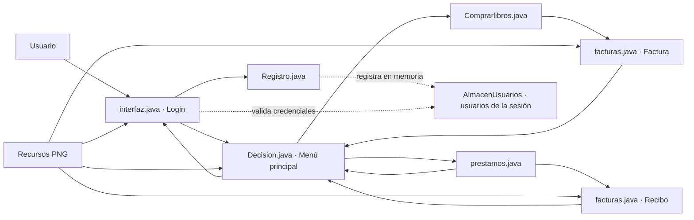
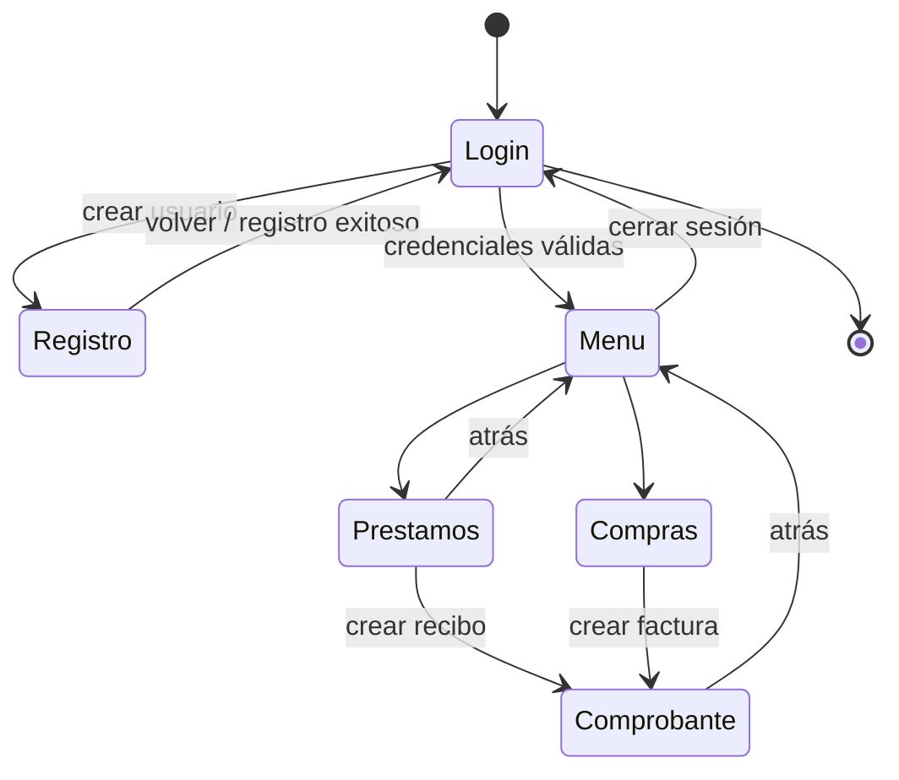
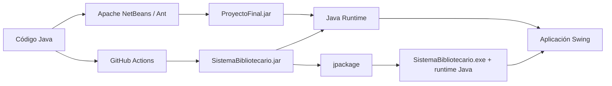

# Arquitectura de Sistema Bibliotecario

Sistema Bibliotecario conserva deliberadamente una arquitectura de escritorio **Java Swing orientada a eventos**, coherente con su origen académico de 2016. La restauración de 2026 estabiliza el flujo sin convertir el proyecto legado en una aplicación de capas moderna que no existía originalmente.

## Vista general



La lógica de selección, cálculo y generación de comprobantes vive dentro de cada ventana, como en el proyecto original.

No existe una capa de persistencia empresarial ni una API externa: el valor del proyecto está en preservar el modelo de programación orientada a objetos, eventos y navegación entre formularios que correspondía al alcance de Programación 1.

### Autenticación de sesión

`AlmacenUsuarios` (añadido en v1.0.1) es una clase auxiliar con un `HashMap` estático que se inicializa con la cuenta de demostración `admin / 1234`. `Registro` agrega usuarios y rechaza nombres repetidos; `interfaz` valida las credenciales contra el mismo mapa. Los datos viven solo en memoria mientras la aplicación está abierta: no hay archivos, base de datos ni almacenamiento de contraseñas fuera del proceso. No es una capa de persistencia ni un servicio; es el soporte mínimo para que el registro y el login sean coherentes.

## Flujo de navegación



Cada transición crea la ventana destino y cierra la actual con `dispose()`, de modo que solo queda una ventana principal abierta. El botón **Exit** de cualquier ventana termina la aplicación.

## Responsabilidades principales

| Componente | Responsabilidad |
|---|---|
| `interfaz.java` | Inicio de sesión, entrada al sistema y ventana Acerca de |
| `Registro.java` | Captura y validación de datos para registro de usuarios de la sesión |
| `AlmacenUsuarios.java` | Usuarios en memoria durante la ejecución, incluida la cuenta `admin / 1234` |
| `Decision.java` | Menú principal, navegación y cierre de sesión |
| `prestamos.java` | Selección de libros sin duplicados y flujo de préstamo |
| `Comprarlibros.java` | Selección de libros sin duplicados, cálculo y flujo de compra |
| `facturas.java` | Presentación dinámica e impresión de factura o recibo |
| `imagenes/` | Recursos visuales utilizados por las ventanas Swing |

## Arquitectura física

```text
SistemaBibliotecario/
├── .github/workflows/        # build-release.yml
├── docs/                     # Documentación técnica y de preservación
├── interfaces/               # Proyecto NetBeans/Ant
│   ├── src/
│   │   ├── imagenes/         # fondito.png, itla.png, userrrrrr.png, logo.png
│   │   └── ventanas/         # Ventanas Swing (.java) y formularios históricos (.form)
│   ├── nbproject/
│   ├── build.xml
│   └── manifest.mf
├── legacy/                   # Artefactos históricos fuera del runtime
├── CHANGELOG.md
└── README.md
```

## Build y ejecución



Los detalles de cada artefacto están en [`EXECUTABLE.md`](EXECUTABLE.md).

## Decisiones de preservación

- Se mantiene Java Swing y la navegación basada en ventanas.
- No se introduce artificialmente MVC, repositorios o una base de datos que el proyecto original no necesitaba.
- Las correcciones se concentran en estabilidad, navegación, comprobantes y compatibilidad.
- La autenticación de sesión se resuelve con una clase auxiliar en memoria, sin JDBC ni servicios externos.
- Los nombres de clase históricos se conservan para no romper la relación con los archivos `.form` de NetBeans.
- La arquitectura documentada describe el sistema real restaurado, no una reescritura hipotética.
